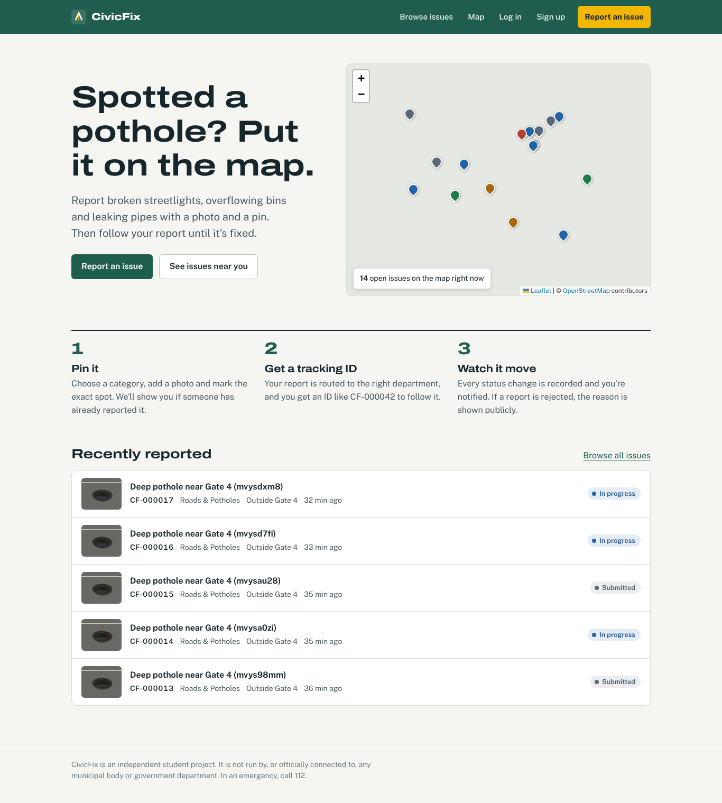
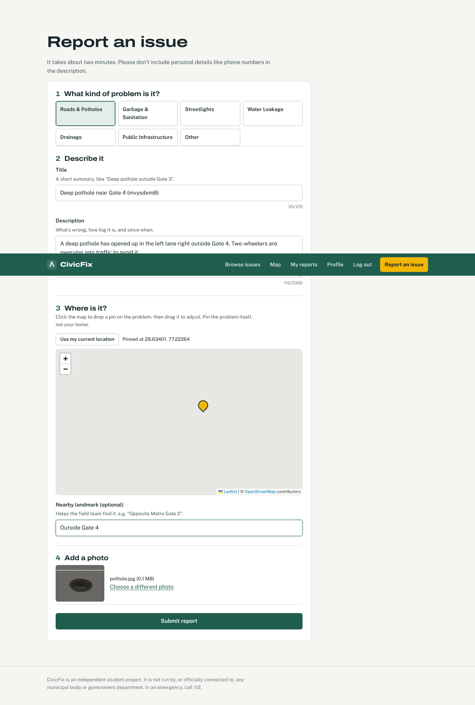
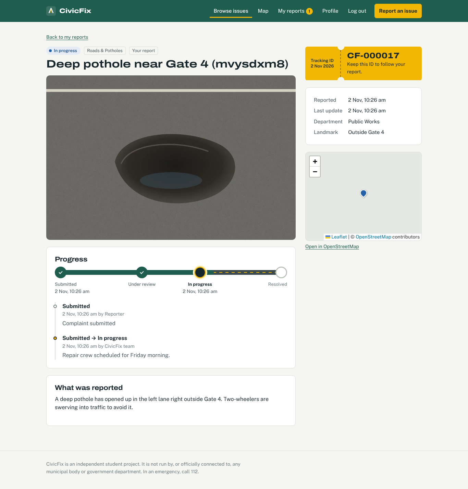
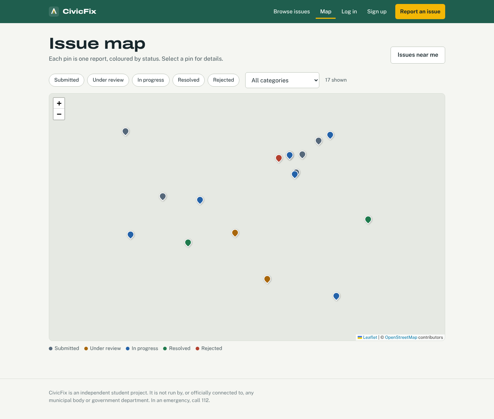
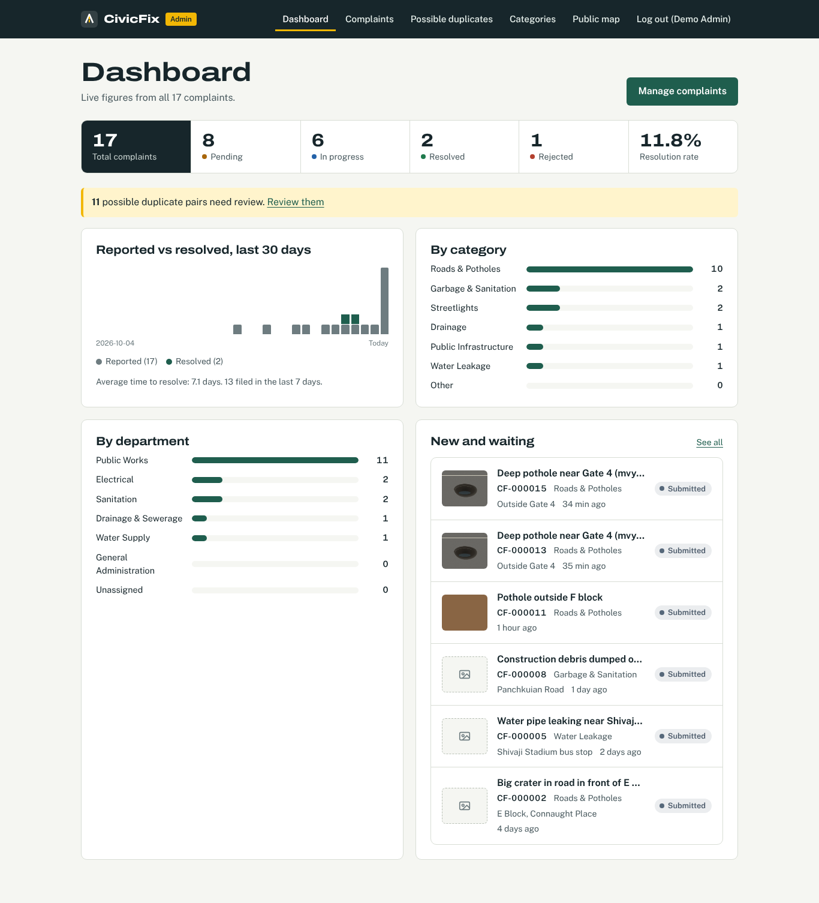
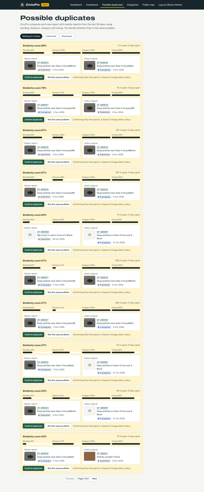
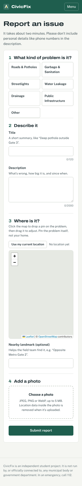
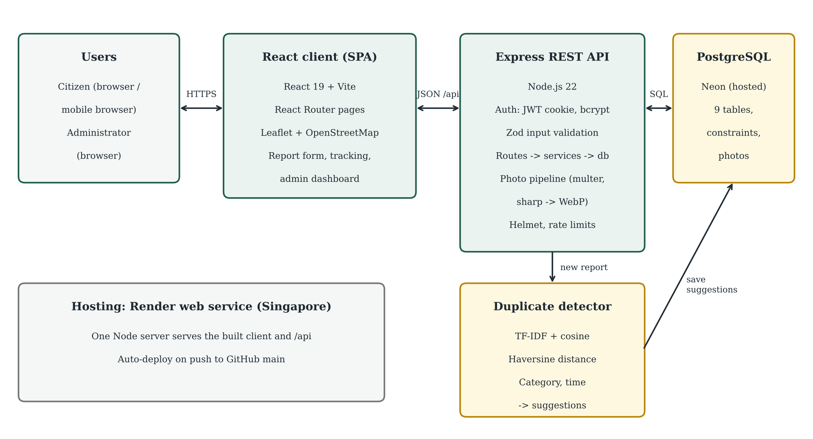
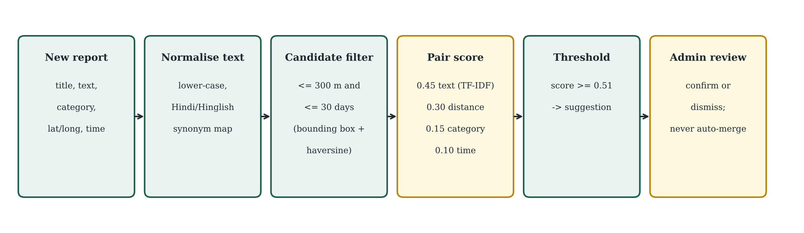

# CivicFix

**Report potholes, garbage, broken streetlights and other civic problems, and track them until they're fixed.**

CivicFix is a full-stack web application. Citizens report a civic issue with a photo and a map pin, get a tracking ID (for example `CF-000042`), and follow it through each status change. Administrators review, assign, resolve or reject reports from a dashboard. An AI-assisted check flags reports that are probably duplicates of one already filed nearby, and an administrator confirms or dismisses each suggestion.

**Live demo:** https://civicfix-jnhd.onrender.com
The free hosting plan sleeps after 15 minutes without visitors, so the first page load can take about a minute.

> CivicFix is a B.Tech (CSE) 3rd-semester team project at IILM University, Gurugram. It is an independent student project and is **not** connected to any municipal body or government department.



---

## Contents

- [Features](#features)
- [Screenshots](#screenshots)
- [Tech stack](#tech-stack)
- [Architecture](#architecture)
- [Duplicate detection](#duplicate-detection-the-ai-part)
- [Run it locally](#run-it-locally)
- [Testing](#testing)
- [Deployment](#deployment)
- [Project structure](#project-structure)
- [Documentation](#documentation)
- [Known limitations](#known-limitations)
- [Team](#team)

---

## Features

**For citizens**
- Register and log in (sessions last 7 days).
- Report an issue: category, title, description, location (map pin or GPS) and a photo.
- See similar reports already filed nearby before submitting.
- Get a tracking ID, and follow the report's full status history.
- Get a notification whenever an administrator changes the report.
- Dashboard with counts by status.

**For everyone (no login needed)**
- Browse and search all reports, with filters for status, category and "near me".
- Interactive map with status-coloured pins.
- Public report pages never show who filed the report.

**For administrators**
- Dashboard with live statistics, a 30-day trend, and counts by category and department.
- Complaint table with 8 filters and an area-on-map filter.
- Change a report's status, priority, category or department. Rejecting a report requires a reason.
- Review queue for AI duplicate suggestions (confirm or dismiss; nothing is merged automatically).
- Manage categories.

**Statuses:** `submitted` → `under_review` → `in_progress` → `resolved`, or `rejected` (a reason is required). Every change is recorded in an append-only history.

---

## Screenshots

| Report an issue | Issue details |
|---|---|
|  |  |
| **Public map** | **Admin dashboard** |
|  |  |
| **Duplicate review** | **Mobile** |
|  |  |

All 15 screenshots are in [`docs/screenshots/`](docs/screenshots).

---

## Tech stack

| Layer | Technology | Why |
|---|---|---|
| Frontend | React 19, Vite 8, React Router 7 | Single-page app; pages change without a full reload |
| Maps | Leaflet 1.9 + react-leaflet, OpenStreetMap tiles | Free and open source; no map API key or billing |
| Backend | Node.js 22, Express 4 | Same language as the frontend; small REST API |
| Validation | Zod 4 | Every request is checked against a schema before it reaches the database |
| Database | PostgreSQL 16 (Neon in production) | Relational data with constraints and transactions |
| Photos | multer + sharp | Upload handling; every photo is re-encoded to WebP, which strips EXIF data such as GPS position |
| Security | bcryptjs, jsonwebtoken, helmet, express-rate-limit | Password hashing, cookie sessions, security headers, rate limits |
| Testing | Vitest, Supertest, Testing Library, Playwright | Unit, API, component and real-browser tests |
| Hosting | Render (web service), Neon (PostgreSQL) | Free tiers; every push to `main` redeploys |

---

## Architecture



- **Three tiers:** React client → Express REST API (`/api/*`) → PostgreSQL.
- In production a **single Node server** serves both the built React app and the API from one address, so the login cookie is first-party and can be marked `Secure`.
- The backend is layered: **routes** handle HTTP, **services** hold the business logic, and the **db** layer holds the SQL. Every query is parameterised.
- **Database:** 9 tables: `users`, `departments`, `categories`, `complaints`, `status_history`, `assignments`, `duplicate_suggestions`, `notifications` and `photos`. Some rules are enforced by the database itself, for example a rejected complaint must have a reason, and a complaint can only have one current department assignment.

**Security:**
- Passwords are hashed with bcrypt.
- The login token is a JWT in an `httpOnly`, `Secure`, `SameSite` cookie, so page scripts can't read it.
- The user's role is read from the database on every request, so a tampered token can't grant admin rights. Nobody can register as an admin.
- Helmet sets security headers, including a Content Security Policy.
- Login and new reports are rate-limited.

Detailed diagrams and user flows: [docs/SPECIFICATION.md](docs/SPECIFICATION.md).

---

## Duplicate detection (the AI part)

Many people report the same pothole. For each new report, CivicFix compares it with reports **within 300 m and 30 days**, scoring each pair as:

| Signal | Weight | How |
|---|---|---|
| Text similarity | 0.45 | TF-IDF vectors + cosine similarity on title and description, with a Hindi/Hinglish synonym map |
| Distance | 0.30 | Haversine distance |
| Same category | 0.15 | |
| Time gap | 0.10 | |

A pair scoring **≥ 0.51** becomes a *suggestion* for an administrator to confirm or dismiss. Reports are never merged automatically.



**Measured results** on a hand-labelled synthetic dataset of 98 reports (the threshold was tuned on the dev split only):

| Method | Test split: P / R / F1 | Stress split: P / R / F1 |
|---|---|---|
| **CivicFix model** (text + distance + category + time) | 100% / 100% / **100%** | 50.0% / 85.7% / **63.2%** |
| Distance only | 58.3% / 100% / 73.7% | 9.1% / 28.6% / 13.8% |
| Same category + distance | 100% / 100% / 100% | 25.0% / 28.6% / 26.7% |
| Text similarity only | 55.6% / 53.6% / 54.5% | 100% / 57.1% / 72.7% |

**What these numbers show:**
- The normal test split was too easy: a simple "same category within 80 m" rule also scored 100%.
- On the stress split, where phone GPS puts reports of one problem 100–180 m apart, the location rules break down. The CivicFix model still found 6 of the 7 duplicate pairs.
- Its weakness is over-flagging different problems of the same category that are 30–40 m apart.
- The samples are small, so these percentages have wide uncertainty.

Reproduce them with `npm run eval:duplicates`. Full write-up: [ml/README.md](ml/README.md).

---

## Run it locally

You need **Node.js 20+** (22 recommended) and **PostgreSQL 16**.

```bash
git clone https://github.com/mohdqrm/civicfix.git
cd civicfix
npm install

# Settings: copy the example and fill in your PostgreSQL user/password,
# a long random JWT_SECRET, and an admin email + password.
cp server/.env.example server/.env

# Creates the database, creates the tables, loads demo data and builds the React app
npm run setup

# Start the server (API + built website) on http://localhost:4000
npm start
```

**Demo logins** (created by `npm run db:seed` in development):
- **Citizen:** `citizen@civicfix.demo` / `Citizen@12345`
- **Admin:** the `SEED_ADMIN_EMAIL` / `SEED_ADMIN_PASSWORD` you set in `server/.env`. Admins log in at `/admin/login`.

**Developing with hot reload:** run `npm run dev:server` and `npm run dev:client` in two terminals, then open http://localhost:5173.

| Command | What it does |
|---|---|
| `npm run setup` | Create the database, run migrations, seed, build the client |
| `npm run db:migrate` / `npm run db:seed` | Apply migrations / load reference and demo data (safe to re-run) |
| `npm start` | Start the production server on port 4000 |
| `npm test` | Server API tests, detector unit tests and client component tests |
| `npm run test:e2e` | Playwright browser tests (set `PW_CHROME` to use an installed Chrome) |
| `npm run eval:duplicates` | Re-run the duplicate detection evaluation |

Step-by-step guides for beginners: [START-HERE-MAC.txt](START-HERE-MAC.txt), plus the running sections in [docs/BACKEND.md](docs/BACKEND.md) and [docs/FRONTEND.md](docs/FRONTEND.md).

---

## Testing

`npm test` needs a second, empty database whose name ends in `_test` (set `TEST_DATABASE_URL` in `server/.env`). The tests wipe and rebuild it on every run and refuse to touch any other database.

| Suite | Tool | Result (run 14 Nov 2026) |
|---|---|---|
| API tests: auth, complaints, admin, security, photo storage | Vitest + Supertest on a real PostgreSQL 16 database | **70 / 70 passed** (twice: photos on disk and photos in the database) |
| Duplicate detector unit tests | Node.js test runner | **8 / 8 passed** |
| Frontend component tests | Vitest + Testing Library | **15 / 15 passed** |
| Browser tests: full citizen → admin → citizen journey, failed submissions, unauthorised access, mobile layout on 7 pages | Playwright, Chrome | **15 / 15 passed** |

Bugs found by these tests, and how each was fixed: [docs/TESTING.md](docs/TESTING.md).

---

## Deployment

The app runs on **Render** (free web service, Singapore region) with a **Neon** PostgreSQL database. [`render.yaml`](render.yaml) is a Render Blueprint, so Render creates the service from it. Every push to `main` redeploys automatically. Step-by-step: [docs/DEPLOYMENT.md](docs/DEPLOYMENT.md).

---

## Project structure

```
civicfix/
├── client/                 React app (Vite)
│   └── src/
│       ├── pages/          Landing, Browse, Map, Report, IssueDetail, Dashboard, Profile, Auth, admin/
│       ├── components/     MapView, StatusRoad, DuplicateCard, Layout, ...
│       ├── lib/            API client, auth context, formatting
│       └── test/           Component tests
├── server/                 Express API
│   ├── src/
│   │   ├── routes/         auth, complaints, categories, admin, ...
│   │   ├── services/       complaint workflow, duplicate detector, image storage, stats
│   │   ├── middleware/     auth, validation, uploads, rate limits, errors
│   │   ├── validation/     Zod schemas
│   │   └── db/             connection pool, migrations (SQL), seed data
│   ├── scripts/            create-db, migrate, seed, evaluate-duplicates
│   └── tests/              API tests (Vitest) and detector unit tests
├── e2e/                    Playwright browser tests
├── ml/                     Duplicate dataset, evaluation results and write-up
├── docs/                   Specification, API, backend, frontend, testing, deployment, screenshots
└── render.yaml             Render deployment blueprint
```

---

## Documentation

| Document | Contents |
|---|---|
| [docs/SPECIFICATION.md](docs/SPECIFICATION.md) | Problem, user roles, functional and non-functional requirements, architecture and user-flow diagrams, development plan |
| [docs/API.md](docs/API.md) | Every REST endpoint, request and response, error format |
| [docs/BACKEND.md](docs/BACKEND.md) | How the backend works, file-by-file, and its design decisions |
| [docs/FRONTEND.md](docs/FRONTEND.md) | Pages, how the frontend talks to the API, design system |
| [docs/TESTING.md](docs/TESTING.md) | Test suites, how to run them, results and bugs found |
| [docs/DEPLOYMENT.md](docs/DEPLOYMENT.md) | Hosting on Render and Neon |
| [ml/README.md](ml/README.md) | Duplicate detection method, dataset, evaluation and limitations |
| [CONTRIBUTING.md](CONTRIBUTING.md) | How the team works: branches, commits and pull requests |

---

## Known limitations

- No password reset or email verification yet, because both need an email service.
- Logging out clears the cookie, but a stolen token stays valid until it expires (7 days).
- Duplicate detection compares text, distance, category and time, but not photos. It was evaluated only on synthetic data written by the team.
- Departments are simulated. CivicFix is not connected to any real municipal system.
- On the free hosting plan the site sleeps after 15 minutes idle.

---

## Team

| Name | Enrolment No. |
|---|---|
| Mohammed Q | 2581001 |
| Preeti Sharma | 2581383 |
| Suhani Agarwal | 2581446 |
| Jeenal Azad | 2581226 |

B.Tech (CSE), Semester III, School of Computer Science and Engineering, IILM University, Gurugram.

**Use of AI tools:** Claude (Anthropic) was used to help write and debug the code and tests, set up deployment, and draft documentation. The team reviewed its output and ran the tests reported above.
