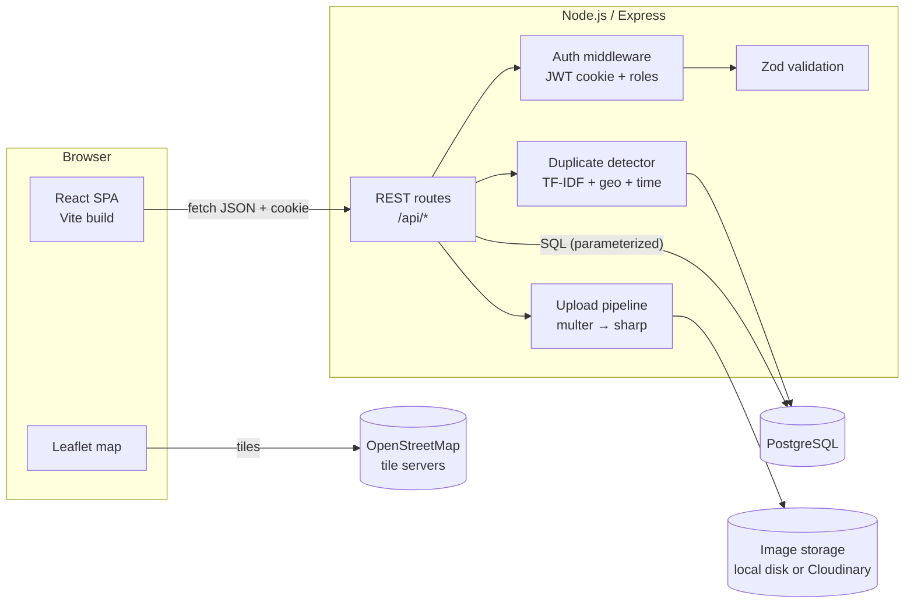
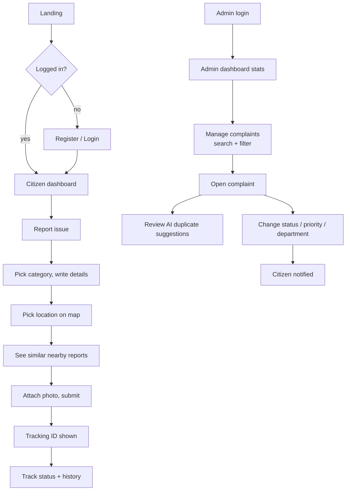

# CivicFix — Project Specification (Step 1)

## 1. Problem and goal

Citizens run into potholes, overflowing bins, dead streetlights, leaking pipes and blocked drains every day, but there is rarely one place to report them with evidence and then see what happened. CivicFix gives citizens that place, and gives administrators one queue to triage, assign and resolve reports — with an AI assistant that spots when several people have reported the same problem.

> CivicFix is an independent student project. It is **not** officially connected to any municipal body or government department.

## 2. User roles

| Role | Can do |
|---|---|
| **Visitor** (not logged in) | View landing page, browse public issues, view public issue details, view the public map |
| **Citizen** | Everything a visitor can, plus: register, log in, report issues with photo + location, see own dashboard, track status history, see notifications, edit own profile |
| **Administrator** | Everything public, plus: view all complaints with reporter contact, search/filter, change status (with notes), set priority, assign departments, review AI duplicate suggestions, manage categories, view statistics |

Admins are created by the seed script / database only — **nobody can register as an admin** through the API.

## 3. Functional requirements

**Accounts**
- FR1 Citizen registers with name, email, password (≥ 8 chars, letter + number).
- FR2 Login / logout for both roles; session lasts 7 days.
- FR3 Role-based access: admin APIs reject citizens with HTTP 403.

**Reporting**
- FR4 Citizen submits: category, title (5–120 chars), description (10–2000 chars), location (map pick or GPS), optional landmark text, one photo (JPEG/PNG/WebP, ≤ 5 MB).
- FR5 System returns a human-readable tracking ID (e.g. `CF-000042`).
- FR6 Before submitting, the citizen sees similar reports already filed nearby.
- FR7 Every status change is recorded in an append-only status history.
- FR8 Citizen is notified (in-app) when their complaint's status changes.

**Statuses:** Submitted → Under Review → In Progress → Resolved, or Rejected (reason required). Admins can reopen.

**Categories:** Roads & Potholes, Garbage & Sanitation, Streetlights, Water Leakage, Drainage, Public Infrastructure, Other.

**Administration**
- FR9 Admin lists all complaints; search by text/ID; filter by category, status, priority, department, area (map radius) and date.
- FR10 Admin updates status, priority, department assignment.
- FR11 Dashboard statistics computed live from the database.
- FR12 AI suggests possible duplicates; admin confirms or dismisses. Nothing is merged or rejected automatically.
- FR13 Admin manages categories (create, rename, deactivate).

**Maps**
- FR14 Public map of complaints with status-coloured markers, category/status filters, "near me".
- FR15 Public views never show reporter name/email/phone.

## 4. Non-functional requirements

| Area | Requirement |
|---|---|
| Security | bcrypt password hashing, JWT in httpOnly cookie, parameterized SQL only, Helmet headers, rate limiting, uploads re-encoded to strip metadata and block disguised files |
| Privacy | Public API returns no reporter identity; photo EXIF (incl. GPS/device) removed |
| Performance | List endpoints paginated; indexes on status, category, user, date, location |
| Usability | Responsive from 360 px phones to desktop; WCAG AA colour contrast; keyboard reachable |
| Reliability | Input validated on client *and* server; consistent JSON error format |
| Maintainability | Modular routes/services, migrations, automated tests |

## 5. MVP vs advanced

**MVP (built):** everything in sections 3–4.

**Advanced (built as extras):** pre-submission similar-issue check; in-app notifications; image re-encoding; admin category management.

**Future (not built):** email/SMS notifications, multilingual UI, upvoting, field-worker mobile role, official municipal integration, image-based duplicate detection.

## 6. System architecture

In production the Express server also serves the built React files, so the browser talks to **one origin**. That keeps the auth cookie simple and avoids cross-site cookie problems.

## 7. User flows

## 8. Technology choices

| Layer | Choice | Why |
|---|---|---|
| Frontend | React 18, Vite, React Router, plain CSS | Requested; no UI framework keeps it understandable |
| Maps | Leaflet + react-leaflet + OSM tiles | Free, no API key |
| Backend | Node 22, Express 4 | Requested; huge ecosystem |
| Validation | Zod | One schema = validation + clear error messages |
| DB | PostgreSQL 16 via `pg` | Requested; raw SQL teaches more than an ORM |
| Auth | bcryptjs + jsonwebtoken in httpOnly cookie | Token can't be read by injected JS |
| Images | multer + sharp; local disk or Cloudinary | sharp re-encodes (security + smaller files) |
| AI | Custom TF-IDF + scoring in JS | Explainable, no extra service, measurable |
| Tests | Vitest, Supertest, Testing Library, Playwright | Requested |

**One deliberate change:** the duplicate detector is written in JavaScript instead of a Python micro-service. For TF-IDF + cosine similarity the maths is ~100 lines, and a second service would double deployment work without improving accuracy.

## 9. Development plan

1. Spec & architecture (this file)
2. Database schema + migrations + seed
3. Express API: auth, complaints, admin, categories
4. Security: RBAC, rate limiting, Helmet, upload hardening
5. Complaint reporting with photo + location
6. Admin dashboard & management
7. Maps & geolocation
8. Duplicate detection + labelled evaluation
9. Automated tests (unit, API, component, end-to-end, security) and bug fixing
10. Docs, deployment config, demo material
