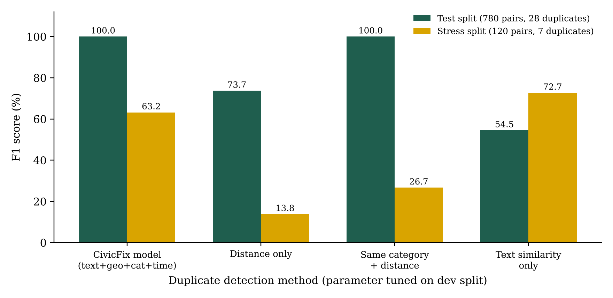

# CivicFix: Testing

This page brings together how CivicFix is tested, how to run each suite, the latest results, and the bugs the tests found. More detail on individual suites is in [BACKEND.md](BACKEND.md) and [FRONTEND.md](FRONTEND.md).

## Test levels

| Level | What it checks | Tool | Where |
|---|---|---|---|
| Unit | Duplicate detector: text normalisation, TF-IDF, scoring, window limits | Node.js test runner | `server/tests/duplicateDetector.node.test.js` |
| API / integration | Every endpoint against a real PostgreSQL database: auth, complaints, admin workflow, security, photo storage | Vitest + Supertest | `server/tests/api/*.test.js`, `server/scripts/test-db-photos.js` |
| Component | Form validation, status road, history, badges, ticket, pagination, accessibility of fields | Vitest + Testing Library | `client/src/test/components.test.jsx` |
| End-to-end | The full user journey in a real browser, failure cases, mobile layout | Playwright + Chrome | `e2e/journey.spec.js`, `e2e/responsive.spec.js` |
| Model evaluation | Precision, recall and F1 of duplicate detection against three baselines | Custom script | `server/scripts/evaluate-duplicates.js`, `ml/` |

## How to run

1. Create a second, empty PostgreSQL database whose name ends in `_test` (for example `civicfix_test`), and put its URL in `server/.env` as `TEST_DATABASE_URL`. The test setup **wipes and rebuilds** this database on every run, and refuses to run against any database whose name doesn't end in `_test`.
2. Run:

```bash
npm test                 # API tests (both photo storage modes), detector unit tests, component tests
npm run test:e2e         # builds the app, starts it on :4000 if needed, drives Chrome
npm run eval:duplicates  # re-computes the duplicate detection results
```

For the browser tests, either run `npx playwright install chromium` once, or point Playwright at an installed Chrome with `PW_CHROME=/path/to/chrome`. They use the development database and the demo accounts from `npm run db:seed`.

## Latest results (14 Nov 2026)

Run on Node.js 22.23 and PostgreSQL 16, from commit `da3b173` on branch `docs/readme-and-project-docs`.

| Suite | Result |
|---|---|
| API tests, photos stored on disk | **70 / 70 passed** (5 files) |
| API tests, photos stored in PostgreSQL (the production setting) | **70 / 70 passed** |
| Photo-in-database check (`test-db-photos.js`) | passed |
| Duplicate detector unit tests | **8 / 8 passed** |
| Frontend component tests | **15 / 15 passed** |
| Browser tests, desktop journey + failures (Chrome, 1366×900) | **7 / 7 passed** |
| Browser tests, mobile layout (Pixel 7 viewport) | **8 / 8 passed** |

### What the API tests cover

| File | Main checks |
|---|---|
| `auth.test.js` | Register, login, logout, `me`; validation; duplicate email; forged JWT and `alg: none` token rejected; profile update; login rate limit returns 429 |
| `complaints.test.js` | Create with photo (row saved, WebP served, EXIF removed); missing, disguised, SVG and oversized files refused; field validation; 401/403; public detail without reporter data; filters, search, pagination; SQL-injection and `%` in search; near-me and distance sort; map data; owner edit rules; similar-report check |
| `admin.test.js` | 401/403 on all admin endpoints; full status workflow with history and notifications; rejection needs a reason (API and database constraint); reopen; priority, category and department changes; statistics compared with direct SQL counts; duplicate detect → confirm/dismiss, never auto-merged; category management |
| `security.test.js` | Security headers (CSP, nosniff, no `x-powered-by`); JSON 404s; no stack traces or SQL in errors; 100 KB body limit; CORS origin; mass assignment ignored; XSS payload stored as inert text; path traversal on `/uploads`; SQL metacharacters in IDs and sort; cookie flags; Referrer-Policy for map tiles |
| `cloudinary.test.js` | Optional Cloudinary driver: request signature matches Cloudinary's documented example; upload request built correctly (mocked) |

### Duplicate detection evaluation

From `npm run eval:duplicates` (threshold tuned on the dev split only):

| Method | Test split P / R / F1 (TP/FP/FN) | Stress split P / R / F1 (TP/FP/FN) |
|---|---|---|
| CivicFix model (text + distance + category + time), threshold 0.51 | 100% / 100% / 100% (28/0/0) | 50.0% / 85.7% / 63.2% (6/6/1) |
| Distance only (≤ 80 m) | 58.3% / 100% / 73.7% (28/20/0) | 9.1% / 28.6% / 13.8% (2/20/5) |
| Same category + distance (≤ 80 m) | 100% / 100% / 100% (28/0/0) | 25.0% / 28.6% / 26.7% (2/6/5) |
| Text similarity only (cosine ≥ 0.28) | 55.6% / 53.6% / 54.5% (15/12/13) | 100% / 57.1% / 72.7% (4/0/3) |



How to read these numbers, and the method's weak spots: [ml/README.md](../ml/README.md).

## Bugs found by testing

| # | Found by | Problem | Fix |
|---|---|---|---|
| 1 | API test (citizen editing) | An admin status change returned 500, so a citizen could still edit the report | PostgreSQL inferred two types for one parameter (error `42P08`); cast it once with `$2::varchar` in `changeStatus()` |
| 2 | Same investigation | That 500 was invisible during tests | Unexpected 500s are now always logged |
| 3 | Code review during smoke test | `/api/categories` showed `defaultDepartment: null` for every category | The field is only included when it was actually queried |
| 4 | Browser console check | Every logged-out page load logged a 401 error | New `GET /api/auth/session` returns `{ user: null }` with status 200 |
| 5 | E2E journey | UI said "In progress", notifications said "In Progress" | Server labels changed to sentence case |
| 6 | E2E second run | Login rate limit tripped by repeated test runs | Limits are configurable; only the test server raises them |
| 7 | API tests after the React build | `/uploads/../.env` and missing photos returned the homepage with status 200 | Only extension-less page URLs get the React app; files and missing photos return real 404s (test added) |
| 8 | Running on a real PC | Map showed pins but no streets | The default `Referrer-Policy: no-referrer` blocked OpenStreetMap tiles; changed to `strict-origin-when-cross-origin` (test added) |
| 9 | Fresh clone (14 Nov) | `npm test` failed unless `TEST_DATABASE_URL` was exported in the shell | The test setup now loads `server/.env` itself |
| 10 | Screenshot review | Tracking ID wrapped onto two lines; status road's first stop misplaced; stray icon when a report had no photo | CSS and rendering fixes |

## Not yet tested

- Page load and API response times were not measured.
- No usability study with real users.
- Duplicate detection has only been evaluated on synthetic reports written by the team.
- The Cloudinary photo driver has only been tested against a mocked request; production stores photos in PostgreSQL instead.
